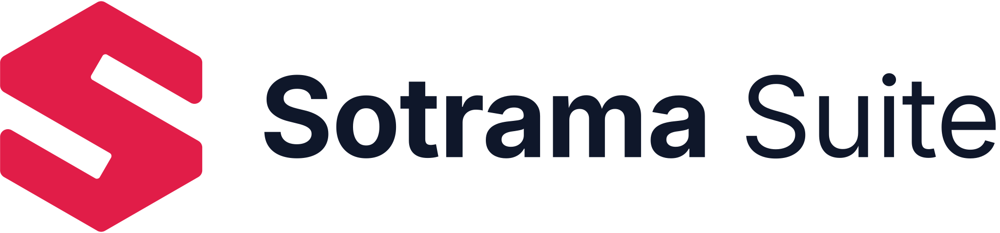

<div align="center" markdown="1">
<br/>



<br/>

<h1>Sotrama Suite</h1>

**Open-Source Tools for Business Operations**

> Sotrama Suite is an open-source, cross-platform business management suite by [aa790933](https://github.com/aa790933), licensed under AGPL-3.0-only.

[](https://github.com/aa790933/Sotrama-Suite/releases)


[](https://github.com/aa790933/Sotrama-Suite/actions/workflows/publish.yml)

</div>

<div align="center">

</div>
<br />
<div align="center">
	<a href="https://github.com/aa790933/Sotrama-Suite">Website</a>
	-
	<a href="https://aa790933.github.io/Sotrama-Suite">Documentation</a>
</div>

## Sotrama Suite

Sotrama Suite is an open-source desktop application for bringing practical business tools together in one place. Its direction is closer to an ERP-style suite than a single-purpose accounting product: business workflows should share company data and work together instead of living in disconnected tools. It is built for Windows, macOS, and Linux, with MariaDB-backed company data that can be hosted locally or on a trusted network.

The current application focuses on the operational and financial workflows already implemented—sales and point of sale, invoices and bills, payments, journal entries, and financial reports. This description is a direction for the suite, not a claim that every ERP module (such as inventory, HR, manufacturing, or CRM) is already available.

<details>
<summary>Screenshots</summary>
<br/>

    <br/><br/>
    
    <br/><br/>
    

</details>

### Motivation

Sotrama Suite aims to give small and medium-sized businesses a practical, extensible collection of connected tools without requiring a collection of separate applications. The priority is to keep everyday workflows approachable, data consistent, and the application maintainable as the suite grows beyond its original financial-management focus.

### Key Features

- **Business overview**: Dashboard views for the operational and financial data currently supported by the application.
- **Sales and point of sale**: Handle retail sales through the integrated POS workflow.
- **Invoices, bills, and payments**: Create sales and purchase documents and record money received or paid.
- **Financial records**: Journal entries and double-entry posting for supported transactions.
- **Reports**: General Ledger, Profit and Loss, Balance Sheet, and Trial Balance.
- **Company setup**: Manage company-specific settings, currency, fiscal year, chart of accounts, and available country/tax defaults.
- **Shared data**: Store company records in MariaDB locally or on a trusted LAN host.
- **Cross-platform desktop**: Electron packages the application for Windows, macOS, and Linux.
    <br/>

### Under the Hood

- **Vue.js**: Vue.js powers the front-end of Sotrama Suite, enabling a reactive and component-based UI. It ensures seamless interactions and dynamic updates, giving users a modern, responsive experience.

- **Electron**: Electron is used to package Sotrama Suite as a standalone desktop application, allowing it to run offline and provide a native-like experience across Windows, macOS, and Linux.

- **MariaDB**: Stores company records, transactions, and configuration. It can run locally or on a trusted LAN host.

## Production Setup

### Manual

Download and install the latest release for your platform from the [releases page](https://github.com/aa790933/Sotrama-Suite/releases) .

### Using Homebrew (for MacOS and Linux)

```zsh
brew install --cask sotrama-suite
```

### Via Flatpak (Linux)

<a href='https://flathub.org/apps/io.github.aa790933.sotrama-suite'>
    
</a>

## Development Setup

### Pre-requisites

To get the dev environment up and running you need to first set up Node.js `v22.12.0` and npm. For this, we suggest using
[nvm](https://github.com/nvm-sh/nvm#installing-and-updating).

Next, you will need to install [yarn](https://classic.yarnpkg.com/lang/en/docs/install/#mac-stable).

### Clone and Run

Once you are through the Pre-requisites, you can run the following commands to
setup Sotrama Suite for development and building:

```bash
# clone the repository
git clone https://github.com/aa790933/Sotrama-Suite.git

# change directory
cd Sotrama-Suite

# install dependencies
yarn
```

To run Sotrama Suite in development mode (with hot reload, etc):

```bash
# start the electron app
yarn dev
```

**Note: First Boot**

When you run `yarn dev` electron will run immediately but the UI will take a
couple of seconds to render this because of how dev mode works. Each file is
individually served by the dev server. And there are many files that have to be
sent.

**Note: Debug Electron Main Process**

When in dev mode electron runs with the `--inspect` flag which allows an
external debugger to connect to port 5858. You can use chrome for this by
visiting `chrome://inspect` while Sotrama Suite is running in dev mode.

See more [here](https://www.electronjs.org/docs/latest/tutorial/debugging-main-process#external-debuggers).

#### Build

To build Sotrama Suite and create an installer:

```bash
# start the electron app
yarn build
```

**Note: Build Target**

By default the above command will build for your computer's operating system and
architecture. To build for other environments (example: for linux from a windows
computer) check the _Building_ section at
[electron.build/cli](https://www.electron.build/cli).

So to build for linux you could use the `--linux` flag like so: `yarn build --linux`.

## Want to Just Try Out or Contribute?

If you want to contribute to Sotrama Suite, please check our [Contribution Guidelines](.github/CONTRIBUTING.md). There are many ways you can contribute even if you don't code:

1. If you find any issues, no matter how small (even typos), you can [raise an issue](https://github.com/aa790933/Sotrama-Suite/issues/new) to inform us.
2. You can help us with language support by [contributing translations](https://github.com/aa790933/Sotrama-Suite/wiki/Contributing-Translations).
3. If you're an ardent user you can tell us what you would like to see.
4. Share the business workflows and tools you would like the suite to support next. 🙂

If you want to contribute code then you can fork this repo, make changes and raise a PR. ([see how to](https://docs.github.com/en/pull-requests/collaborating-with-pull-requests/proposing-changes-to-your-work-with-pull-requests/creating-a-pull-request-from-a-fork))

## Credits

Sotrama Suite is built by [aa790933](https://github.com/aa790933).
Original project: https://github.com/frappe/books (forked)
License: [AGPL-3.0-only](LICENSE)

## Translation Contributors

| Language              | Contributors                                                                                                                                                                                                                                      |
| --------------------- | ------------------------------------------------------------------------------------------------------------------------------------------------------------------------------------------------------------------------------------------------- |
| Arabic                | [taha2002](https://github.com/taha2002), [Faridget](https://github.com/faridget), [Osama Muhammed](https://github.com/osama1998H)                                                                                                                 |
| Albanian              | [xoniks](https://github.com/xoniks)                                                                                                                                                                                                               |
| Catalan               | Dídac E. Jiménez                                                                                                                                                                                                                                  |
| Chinese - Simplified  | [wcxu21](https://github.com/wcxu21), [wolone](https://github.com/wolone), [Ji Qu](https://github.com/winkidney)                                                                                                                                   |
| Chinese - Traditional | [Ethan Deng](https://github.com/ethandengs)                                                                                                                                                                                                       |
| Danish                | [Tummas Joensen](https://github.com/slang123)                                                                                                                                                                                                     |
| Dutch                 | [RijckAlex](https://github.com/RijckAlex), [Stan M](https://github.com/stxm)                                                                                                                                                                      |
| French                | [DeepL](https://www.deepl.com/), [mael-chouteau](https://github.com/mael-chouteau), [joandreux](https://github.com/joandreux)                                                                                                                     |
| German                | [DeepL](https://www.deepl.com/), [barredterra](https://github.com/barredterra), [promexio](https://github.com/promexio), [C2H6-383](https://github.com/C2H6-383), [0xflotus](https://github.com/0xflotus), [Tim](https://github.com/Rocket-Quack) |
| Gujarati              | [dhruvilxcode](https://github.com/dhruvilxcode), [4silvertooth](https://github.com/4silvertooth)                                                                                                                                                  |
| Hindi                 | [bnsinghgit](https://github.com/bnsinghgit)                                                                                                                                                                                                       |
| Indonesian            | [Aji Prakoso](https://github.com/jipraks)                                                                                                                                                                                                         |
| Korean                | [Isaac-Kwon](https://github.com/Isaac-Kwon)                                                                                                                                                                                                       |
| Portuguese            | [DeepL](https://www.deepl.com/), [Valdir Amaral](https://github.com/valdir-amaral)                                                                                                                                                                |
| Spanish               | [talmax1124](https://github.com/talmax1124), [delbertf](https://github.com/delbertf), [Ignacio Chemes](https://github.com/ignaciochemes)                                                                                                          |
| Swedish               | [papplo](https://github.com/papplo), [Crims-on](https://github.com/Crims-on)                                                                                                                                                                      |
| Turkish               | Eyuq, [XTechnology-TR](https://github.com/XTechnology-TR)                                                                                                                                                                                         |

## Learn and connect

- [Telegram Group](https://t.me/sotrama_suite): Used for discussions and decisions regarding everything Sotrama Suite.
- [GitHub Discussions](https://github.com/aa790933/Sotrama-Suite/discussions): Used for discussions around a specific topic.
- [Documentation](https://aa790933.github.io/Sotrama-Suite): Official documentation for more details.
