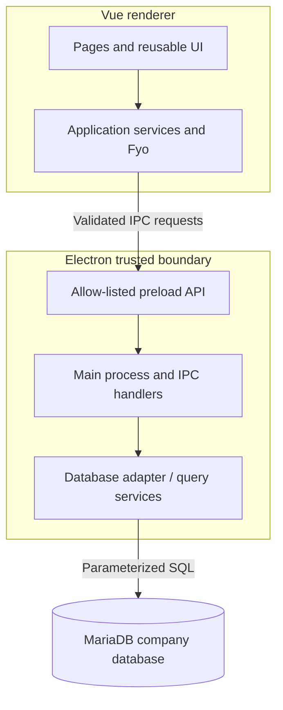
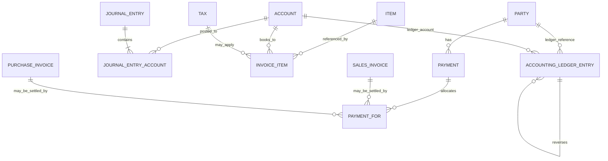
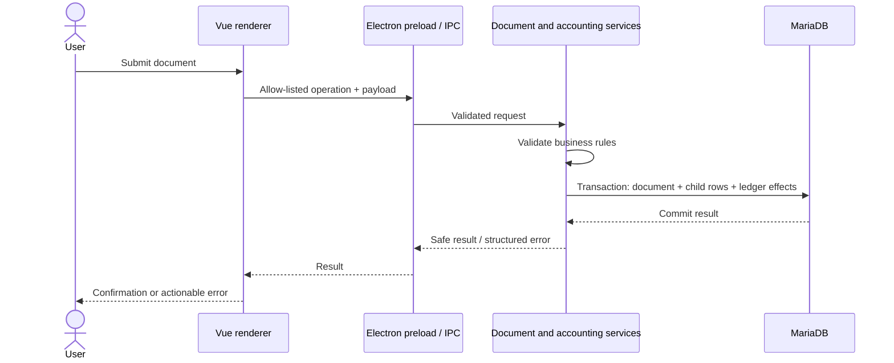

# Data model and UML

These diagrams document the architecture represented by the repository's schema definitions. They are a navigational model, not a substitute for the installed MariaDB schema or a claim that every association is enforced by a physical foreign-key constraint. The canonical model definitions live in `schemas/app`, `schemas/core`, and `schemas/meta`.

## Application component diagram

The renderer owns presentation and interaction. The Electron main process and database services own privileged operations and database access. Do not pass credentials or raw database connections into renderer components.

## Core business ER diagram

`Invoice`, `InvoiceItem`, and `PaymentFor` are schema abstractions/child rows used by concrete transaction models. In particular, `PaymentFor.referenceType` plus `referenceName` is a dynamic reference, so the diagram represents a logical relationship rather than a conventional single-target foreign key. Confirm runtime-specific constraints in the active database before planning a migration.

## Important entity responsibilities

| Entity | Responsibility | Key associations defined in schema |
| --- | --- | --- |
| `Party` | Customer/supplier contact and billing defaults | `Address`, `Account`, `Currency`, `Lead`, `LoyaltyProgram` |
| `SalesInvoice` / `PurchaseInvoice` | Submitted sales/purchase documents | Shared invoice fields, line items, taxes and totals |
| `InvoiceItem` and concrete item schemas | Document lines, quantity, rate, account and tax | `Item`, `Account`, `Tax`, `UOM`, optional `Batch` |
| `Payment` | Receipt or disbursement | `Party`, source/destination `Account`, `PaymentMethod`, child `PaymentFor` allocations |
| `JournalEntry` | Manual accounting transaction | Child `JournalEntryAccount` rows and `NumberSeries` |
| `AccountingLedgerEntry` | Read-only posted ledger facts and reversals | `Party`, `Account`, dynamic source document reference, optional reversal reference |

## Data integrity and migration rules

- Use the schema's `Link`, `Table`, and `DynamicLink` metadata as the starting point for relationship discovery; inspect model hooks and database migrations before assuming physical constraints.
- Treat submitted financial documents and ledger rows as accounting records: use existing posting/reversal services and transaction boundaries rather than editing derived balances directly.
- Preserve parent/child atomicity for invoice lines, journal accounts, and payment allocations.
- Bind SQL values as parameters. Validate and quote identifiers against trusted schema metadata; never interpolate user-controlled identifiers into SQL.
- Test schema changes against a disposable MariaDB database with representative existing data and a verified backup/restore path.

## UML sequence: posting a financial document

This is the intended boundary and lifecycle model. Specific document types may have additional inventory, tax, payment, or integration steps; consult their model implementations before changing transaction behavior.
